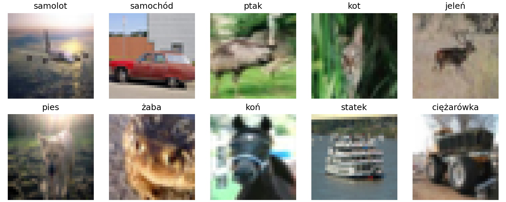

# Klasyfikacja obrazów CIFAR-10 z użyciem CNN i MobileNetV2

Projekt porównuje własną sieć konwolucyjną trenowaną od podstaw z MobileNetV2 wykorzystującym wagi z ImageNet. Dodatkowy trening własnej CNN z augmentacją pozwala zmierzyć jej wpływ na wyniki. Najwyższą trafność uzyskał **MobileNetV2 po częściowym dostrojeniu (88,76%)**.

[Raport PDF](Proj2Rap.pdf) · [Wyniki CSV](results/20261113-005142-732453/comparison.csv) · [Ustawienia przebiegu](results/20261113-005142-732453/settings.json)

## Dane i warianty

CIFAR-10 zawiera 60 000 kolorowych obrazów 32 × 32 w 10 klasach. Z oficjalnej części treningowej wydzielono po 4 500 obrazów na klasę do treningu i po 500 do walidacji. Każdy wariant oceniono na pełnym oficjalnym zbiorze testowym obejmującym 10 000 obrazów.



| Wariant | Zakres treningu |
| --- | --- |
| Własna CNN | Trzy bloki konwolucyjne i klasyfikator uczone od podstaw. |
| CNN z augmentacją | Ta sama architektura i podział danych. Podczas treningu stosowano losowe odbicia poziome i przesunięcia do 10% rozmiaru obrazu. |
| MobileNetV2 z zamrożoną bazą | Baza obliczała 1 280 cech dla obrazu powiększonego do 96 × 96. Uczono tylko głowicę z 10 wyjściami. |
| MobileNetV2 po fine-tuningu | Kontynuowano trening głowicy i końcowych warstw bazy od `block_13_expand`, zachowując zamrożone warstwy Batch Normalization. |

## Wyniki testowe

| Wariant | Trafność | F1 macro | Strata | Parametry trenowane | Łączny trening | Wnioskowanie [ms/obraz] |
| --- | ---: | ---: | ---: | ---: | ---: | ---: |
| Własna CNN | 86,16% | 0,8608 | 0,4886 | 288 746 | 58 min 18 s | 0,192 |
| CNN z augmentacją | 87,96% | 0,8788 | 0,3643 | 288 746 | 99 min 13 s | 0,195 |
| MobileNetV2 z zamrożoną bazą | 86,26% | 0,8625 | 0,4009 | 12 810 | 2 min 20 s | 2,522 |
| MobileNetV2 po fine-tuningu | **88,76%** | **0,8877** | **0,3436** | 1 676 170 | 43 min 32 s | 2,612 |

Augmentacja poprawiła trafność CNN o **1,80 pkt proc.**, a dostrajanie poprawiło trafność MobileNetV2 o **2,50 pkt proc.** względem zamrożonej bazy. Zamrożona baza wymagała najmniej czasu na trening. CNN z augmentacją przetwarzała partię obrazów około 13 razy szybciej niż dostrojony MobileNetV2.

Czasy pochodzą z jednego przebiegu na procesorze Intel Core i7-10700KF. Czas treningu MobileNetV2 uwzględnia ekstrakcję cech i trening głowicy, a w wariancie dostrojonym także dodatkowy etap uczenia. Czas wnioskowania mierzono dla partii 128 obrazów.

## Wykresy i macierze pomyłek

Wagi wybierano według najniższej straty walidacyjnej. Early stopping kończył etap po 15 epokach bez poprawy. W macierzach wiersz odpowiada klasie rzeczywistej, a kolumna klasie przewidzianej. Kolor oznacza odsetek w obrębie rzeczywistej klasy.

| Wariant | Krzywe uczenia | Macierz pomyłek |
| --- | --- | --- |
| Własna CNN | [Wykres](results/20261113-005142-732453/cnn/learning_curves.png) | [Macierz](results/20261113-005142-732453/cnn/confusion_matrix.png) |
| CNN z augmentacją | [Wykres](results/20261113-005142-732453/cnn_augmented/learning_curves.png) | [Macierz](results/20261113-005142-732453/cnn_augmented/confusion_matrix.png) |
| MobileNetV2 z zamrożoną bazą | [Wykres](results/20261113-005142-732453/feature_extraction/learning_curves.png) | [Macierz](results/20261113-005142-732453/feature_extraction/confusion_matrix.png) |
| MobileNetV2 po fine-tuningu | [Wykres](results/20261113-005142-732453/fine_tuning/learning_curves.png) | [Macierz](results/20261113-005142-732453/fine_tuning/confusion_matrix.png) |

## Uruchomienie

W terminalu z aktywnym środowiskiem Python 3.11, w katalogu projektu, uruchom:

```sh
python -m pip install "tensorflow==2.21.0" "keras==3.12.4" numpy scikit-learn matplotlib
python main.py --train-per-class 4500 --val-per-class 500 --test-per-class 1000 --epochs 1000 --fine-tune-epochs 1000 --batch-size 128 --seed 2026
```

Keras pobiera CIFAR-10 i wagi ImageNet przy pierwszym użyciu. Każdy przebieg tworzy osobny podfolder w `results/`, gdzie zapisuje ustawienia, metryki, wykresy i modele.
